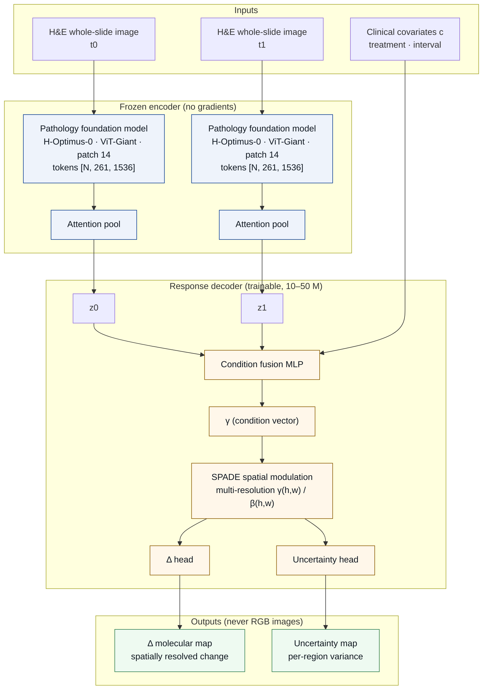

# Architecture — LVMRP

The pathology foundation model is the **worked embodiment** (H-Optimus-0, ViT-Giant, patch 14, 224 × 224 input, token tensor `[N, 261, 1536]`). It is frozen end to end and is **replaceable** — UNI, Virchow or Prov-GigaPath are expected to work with the same downstream design, subject to matching the token dimension.

The condition is injected through **multi-resolution SPADE spatial modulation**, not through a global FiLM vector. The reason is the failure mode recorded in [README §4](../README.md#4-current-evidence--honest-disclosure): condition sensitivity L1 of 0.0112 in the static route, i.e. a condition signal that is averaged away.

Nothing in this diagram produces an RGB stained image. The output is two maps: a quantitative delta map and an uncertainty map.
